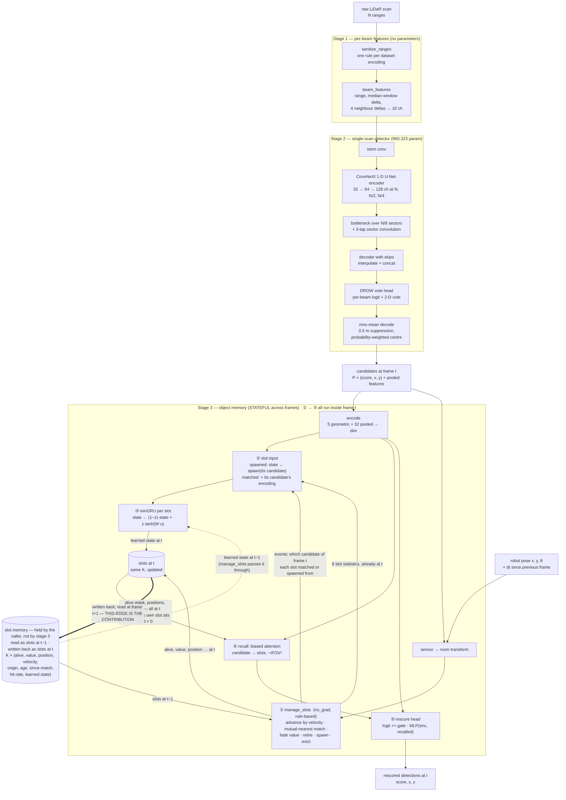

# TAKHeLiPeD — the architecture, frozen on FROG

**T**(emporal) **A**(daptive) **K**(nee-)**He**(ight) **Li**(dar) **Pe**(rson) **D**(etector) — person detection from a
single knee-height 2-D LiDAR.

> **STATUS: NOT YET FROZEN.** Three measurements and one code defect are outstanding, and each is named inline as `PENDING`. The structural
> description below is settled; the numbers in [Proposed FROG parameters](ARCHITECTURE.md#5-proposed-frog-parameters) are either
> measured (and cited) or marked pending. Nothing here may be quoted until the status line says frozen.
>
> | outstanding | what it decides | `TODO.md` |
> | --- | --- | --- |
> | slot capacity, 128 against 256 | one row of the parameter table | item 50 |
> | Slot Attention's own update | one row of the ablation ledger | item 53 |
> | the three-seed freeze | **every number in the results table** | item 47 |
> | a spawned slot's first update reads candidate 0, not its own | whether ② is drawn as the code does it; gates item 47 | item 54 |

This document is **per-dataset by design**. The structure is general; the *parameters* are fitted to FROG and are
expected to differ elsewhere. Later datasets get their own parameter sections rather than edits to this one.

---

## 1. Why FROG was the development dataset

Four properties, and the first is the one that mattered most.

**40.01 Hz.** FROG is the fastest of the three datasets here by a wide margin — DROW runs at 12.5 Hz and annotates
every fifth scan. A detector whose entire claim is about *temporal* evidence needs frames close enough together that
"what was here a moment ago" is a real question, and dense enough annotation to score it. FROG gives a 25 ms frame
period and annotates every frame.

**A large, varied venue.** The robot covers **670–1,260 m of path per recording** across a floor **120–250 m** wide
(`memory/dataset-properties.md`). That matters for a design whose central claim is *room* coordinates: the property
being exploited is that a static object keeps its world coordinate across a 150 m traversal, which is a stronger
statement than "a room".

**Hand-made annotations on real public behaviour.** A science museum gives crowds, queues, people standing still at
exhibits and people walking through — the stationary/moving mix the memory is supposed to exploit, rather than a
scripted route.

**Published baselines to compare against on the same split** — LFE-Peaks and LFE-PPN, both scored here under the same
protocol.

**The honest caveat**: FROG is one venue. Agreement with DROW on the shape of the temporal curve is evidence the
effect is not venue-specific; it is not evidence that it is universal (`memory/dataset-properties.md`).

---

## 2. How the architecture was chosen

Fourteen architectural questions were measured against E13's **1.32 pp** three-sigma bar on FROG `official` test,
stride 5. **Two were load-bearing.** The full ledger with numbers is in
[`../memory/detector-architectures.md`](../memory/detector-architectures.md); this is the summary.

| question | verdict |
| --- | --- |
| **per-object addressability** (item 36) | **load-bearing** — one global state keeps only **6%** of the memory's gain |
| **object vs spatial binding** (item 22) | **load-bearing** — room-cell slots at the same capacity keep **44%** |
| recurrence: selective / GRU / minGRU (16) | tie → minGRU, because a citable cell beats a re-implemented one |
| association: mutual / Hungarian (43) | tie on accuracy **and** CPU → mutual |
| position refinement (46) | tie; coverage unchanged → dropped |
| the 1 s curriculum (41) | tie, 24% cheaper → **removed** |
| whole-scan aggregator (40) | tie → **removed** |
| slot-state width (49) | tie, **−28% CPU** → **`dim 64`** |
| attention heads (49) | tie, no cost change → 4 |
| stage-2 beam target (44a) | **+0.69 pp at three seeds** → **soft Gaussian** |
| the published voteless head (44b) | −7.4 pp even on its own objective → dropped |
| block, widths, depth, kernel, expansion (19, 45) | all tie → defaults kept |
| sensor-frame vote targets (18) | **worse** → beam frame |
| Slot Attention's own update (42) | `PENDING` — item 53 |

**Nine ties are the finding about everything except the two load-bearing rows.** Each was resolved toward the cheaper
or simpler option, which is why the adopted model is *smaller* than the one the project started with.

**What the two load-bearing results mean together.** Item 36 says the memory must be **addressable**; item 22 says the
addressing must be **to objects, not to places**. Neither alone is the contribution — together they are.

---

## 3. The architecture

Three stages. Stage 2 reads **one scan** and has no state, so every temporal claim belongs to stage 3.

**The edge from `slots at t` back into the slot memory is the architecture's whole point.** The memory is drawn
outside stage 3 because that is where it lives in the code: `ObjectMemory` holds no state between calls, every
caller does `slots = out.slots`, so stage 3 takes the slots as an input and returns the new ones as an output beside
its detections. Stages 1 and 2 are
*stateless*: they see one scan and nothing else, which is what makes every temporal claim attributable to stage 3.
Stage 3 is a **recurrence over frames** — `step(candidates, pose, dt, slots) → (detections, slots′)`, and the caller
carries `slots′` into the next call. A person who was seen a moment ago is still in a slot; that is how the memory
rescores a weak candidate the single-scan detector would have discarded.

Two consequences follow from the loop and are worth stating with it. It is **online and causal** — one scan per call,
no lookahead, no `T`-scan window, which is why the detector runs at batch 1 on a robot. And the state is **carried
per stream**, so `reset` exists to empty it at a recording boundary; without that, one recording's slots would leak
into the next.

### Stage 1 — per-beam features, no parameters

`sanitize_ranges` maps every "nothing within range" encoding — FROG's `+inf` and 61.0 m, DROW's 29.96 m — onto one
value, so **the model is fed raw data with no per-dataset cleaning step**. `beam_features` then gives each beam its
range, its deviation from a median window, and deltas to four neighbours: **10 channels**, no learned parameters.

### Stage 2 — a single-scan ConvNeXt 1-D U-Net

A 1-D U-Net over the beam axis built from ConvNeXt blocks (depthwise `k=7`, GroupNorm, inverted bottleneck ×4, GELU,
residual), widths (32, 64, 128) at `N`, `N/2`, `N/4`, a bottleneck over `N/8` sectors with a 3-tap convolution across
sectors, and skip connections on the way up. The head is **DROW's**: a person logit and a 2-D vote toward the person's
centre per beam — deliberately unchanged, so the comparison against DROW3 and DR-SPAAM is an *architecture*
comparison and not a head comparison.

**Trained against a soft Gaussian beam target** (item 44a): each beam's classification target is
`exp(−d² / 2σ²)` in **metres**, clipped to 1 where people overlap, over exactly the beams the hard label marked
positive. The vote loss and the class balance are untouched.

Decoding is **`nms-mean`**: beams in probability order, each kept beam's vote a detection, votes within 0.5 m
suppressed, the detection placed at the probability-weighted mean of the votes it suppressed.

*It has no state and no pose.*

### Stage 3 — an object memory of slots in room coordinates

`K` slots. Each carries a **room-frame position and velocity**, where it started, its age, time since it last matched,
a recent match rate, an accumulated **value**, and a learned state vector.

Per call: the robot's pose puts candidates into room coordinates; **rule-based bookkeeping under `no_grad`** decides
which slot each candidate belongs to (mutual nearest within a gate) and which slots live, spawn, are evicted or
retire; **minGRU** updates each surviving slot's state; a **biased recall attention** lets each candidate read the
slots near it, with an additive distance bias `−d² / 2σ²`; and a **rescoring head** adjusts each candidate's score
from its own encoding plus what it recalled.

> **`PENDING` — item 54, a defect in ②.** The diagram draws the intended rule; the code gets it right for a matched slot
> and wrong for a spawned one. `step` gathers the candidate encoding by `events.match_index`, which is `-1` for a slot
> spawned this frame, and the `clamp(min=0)` turns that into candidate 0 — the frame's strongest — while the mask
> `matched | refill` still lets it in. The spawned state itself, `spawn(own encoding)`, is correct, and so are the
> statistics. Every stage-3 number on the adopted recipe was trained with the defect.

**The bookkeeping is not learned, and that is the design** — spawning, matching, eviction and retirement are discrete
decisions with no gradient to give. Only the slot state, the recurrence and the rescoring head are trained.

**What stage 3 does not have**, each removed by its own measurement: no cross-attention association (E7), no
slot-to-slot self-attention (E6, the only O(K²) term), no coasting head (item 24), no bound on the rescoring
correction (O1), no curriculum (item 41).

---

## 4. Parametrisable

These are **structural choices held fixed** and **values expected to change per dataset**. Everything in §5 is a
value for FROG, not a property of the method.

| parametrisable | flag | why it is dataset-dependent |
| --- | --- | --- |
| input beam count `N` | from the dataset | FROG 720 over 270°, DROW 450, JRDB 1091 over 360° |
| `max_range_m` | `--max-range-m` | sensor and venue |
| slot capacity `K` | `--slots` | how many people are ever simultaneously in view |
| slot-state width `dim` | `--dim` | capacity/CPU trade, retuned per deployment target |
| attention heads | `--heads` | — |
| recall width `sigma_m` | `--sigma-m` | person spacing and match radius |
| association gate `gate_m` | — | match radius |
| value fade `fade_time_s` | — | how long an absent person should be remembered |
| beam-target width | `--label-sigma-m` | annotation radius and beam density |
| NMS radius | `--nms-radius` | person spacing |
| chunk length | `--chunk-s` | frame rate — 10 s is 399 frames at 40 Hz, 125 at 12.5 Hz |
| recurrence | `--recurrence` | `mingru` adopted; `selective` reads real elapsed time and is untested where the rate varies |
| frame | `--room-frame` | needs odometry; `--no-room-frame` where there is none |

---

## 5. Proposed FROG parameters

Fitted to FROG `official`. **Other datasets get their own section; do not carry these over.**

### 5.1 Values

| parameter | value | basis |
| --- | --- | --- |
| beams `N` / field of view | 720 / 270° | dataset |
| `max_range_m` | 10.0 | dataset |
| stage-2 channels | (32, 64, 128) | tie, item 19b |
| kernel / expansion / blocks | 7 / 4 / (2,2,2) | tie, item 45 |
| whole-scan aggregator | **off** | tie, item 40 |
| beam-target `--label-sigma-m` | **0.3 m** | **+0.69 pp at 3 seeds**, item 44a |
| label radius | 0.6 m | DR-SPAAM convention |
| decoder / NMS radius | `nms-mean` / 0.5 m | flat optimum, items 13/17/34 |
| slot capacity `K` | **`PENDING` — 256 or 128** | item 50 |
| slot-state `dim` | **64** | tie, **−28% CPU**, item 49 |
| heads | 4 | tie, item 49 |
| recurrence | **minGRU** | tie; citable, item 38 |
| `sigma_m` | 0.6 m | dose-response, item 39 |
| `gate_m` | 0.6 m | S4, unbinding |
| `fade_time_s` | 10 s | 95% of gain inside 10 s, E1 |
| frame | room | +1.31 pp over sensor frame (A51 E2) |
| chunk length | 10 s, no curriculum | tie, 24% cheaper, item 41 |
| exchange / learned match / coasting | all off | E6, E7, item 24 |

### 5.2 Results

> **`PENDING` — the freeze (item 47).** The adopted combination (soft labels **and** `dim 64`) has never been run end
> to end: `dim 64` was measured on the hard-label stage 2 and the target adopted afterwards. Seed 0 of the freeze is
> the first measurement of it, and is run as a **gate** before the other two seeds.

| metric | value | status |
| --- | --- | --- |
| wp-AUC, FROG `official` test, stride 5, 3 seeds | `PENDING` | item 47 |
| stage-2 candidates AP | 82.79% (3-seed mean) | measured |
| memory gain over candidates | `PENDING` | item 47 |
| CPU ms/frame, 4 threads, batch 1 | **17.73** median / 20.5 p99 | measured, item 49 |
| — of which stage 2 / decode / memory | 9.35 / 1.68 / 6.70 | measured |
| phantoms per person-free frame | `PENDING` | `empty_scene.py` at 3 seeds |
| stage-2 parameters | 960,323 | measured |
| stage-3 parameters | `PENDING` (depends on `K`) | item 50 |

**The CPU figure is the one that decides deployment** (owner, 2026-10-19): FROG's frame period is **25 ms**, so
17.73 ms median leaves 7.3 ms of headroom and the p99 leaves ~4.5 ms. A GPU number does not substitute.

### 5.3 Artifact

> **`PENDING` — produced by the freeze.** The citable artifact will be a versioned directory holding the stage-2 and
> stage-3 checkpoints for all three seeds, their `step3a_results.json`, the CPU latency JSON, and a manifest naming
> the git commit that produced them.

---

## 6. Other datasets

Not yet written. `TODO.md` steps 0–3 cover FROG `balanced`, DROW, FROG→DROW zero-shot and JRDB. Each gets its own
parameter table and its own notes here, beside this one rather than replacing it.
