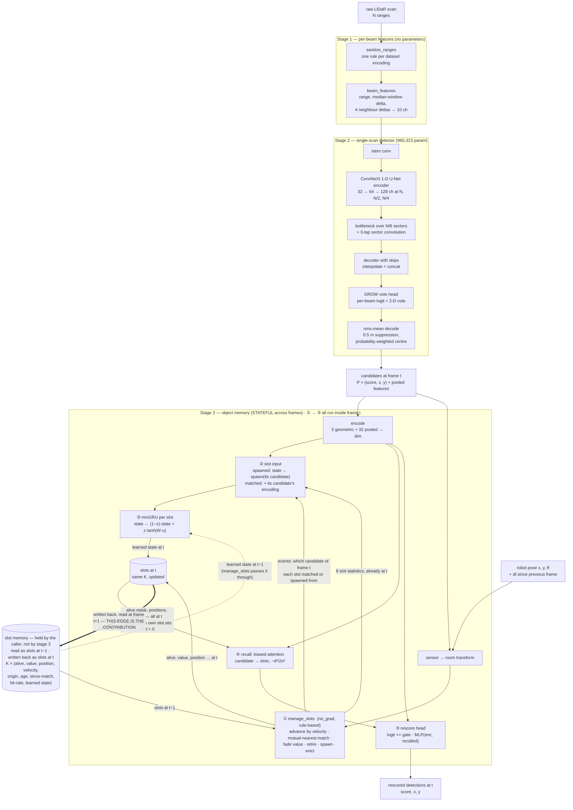

# TAKHeLiPeD — the architecture, frozen on FROG

**T**(emporal) **A**(daptive) **K**(nee-)**He**(ight) **Li**(dar) **Pe**(rson) **D**(etector) — person detection from a
single knee-height 2-D LiDAR.

> **STATUS: FROZEN 2026-10-30**. Every cell in
> [Proposed FROG parameters](ARCHITECTURE.md#5-proposed-frog-parameters) is measured and cited; nothing is pending.
> Three seeds, FROG `official` test: **86.29%** wp-AUC (sd 0.17 pp), **19.32 ms** median on the CPU against a 25 ms
> frame period, **0.596** phantoms per person-free frame. The citable artifact is
> `weights_archive/frozen-frog-2026-10-30/`.
>
> **The CPU figure is measured twice, in two independent sessions, and agrees to 0.4%** — 19.32 ms on a host idle for
> 63 minutes and 19.39 ms on one two minutes past a 7-hour GPU job. The cold run is the one
> quoted, because its noise floor is four times tighter.
>
> **This freezes the architecture on FROG, not on every dataset.** Section 6 is still unwritten, and the parameters
> here are fitted to FROG by design.

This document is **per-dataset by design**. The structure is general; the *parameters* are fitted to FROG and are
expected to differ elsewhere. Later datasets get their own parameter sections rather than edits to this one.

---

## 1. Why FROG was the development dataset

Four properties, and the first is the one that mattered most.

**40.01 Hz.** FROG is the fastest of the three datasets here by a wide margin — DROW runs at 12.5 Hz and annotates
every fifth scan. A detector whose entire claim is about *temporal* evidence needs frames close enough together that
"what was here a moment ago" is a real question, and dense enough annotation to score it. FROG gives a 25 ms frame
period and annotates every frame.

**A large, varied venue.** The robot covers **670–1,260 m of path per recording** across a floor **120–250 m** wide
(`memory/dataset-properties.md`). That matters for a design whose central claim is *room* coordinates: the property
being exploited is that a static object keeps its world coordinate across a 150 m traversal, which is a stronger
statement than "a room".

**Hand-made annotations on real public behaviour.** A science museum gives crowds, queues, people standing still at
exhibits and people walking through — the stationary/moving mix the memory is supposed to exploit, rather than a
scripted route.

**Published baselines to compare against on the same split** — LFE-Peaks and LFE-PPN, both scored here under the same
protocol.

**The honest caveat**: FROG is one venue. Agreement with DROW on the shape of the temporal curve is evidence the
effect is not venue-specific; it is not evidence that it is universal (`memory/dataset-properties.md`).

---

## 2. How the architecture was chosen

Fourteen architectural questions were measured against E13's **1.32 pp** three-sigma bar on FROG `official` test,
stride 5. **Two were load-bearing.** The full ledger with numbers is in
[`../memory/detector-architectures.md`](../memory/detector-architectures.md); this is the summary.

| question | verdict |
| --- | --- |
| **per-object addressability** | **load-bearing** — one global state keeps only **6%** of the memory's gain |
| **object vs spatial binding** | **load-bearing** — room-cell slots at the same capacity keep **44%** |
| recurrence: selective / GRU / minGRU (16) | tie → minGRU, because a citable cell beats a re-implemented one |
| association: mutual / Hungarian (43) | tie on accuracy **and** CPU → mutual |
| position refinement (46) | tie; coverage unchanged → dropped |
| the 1 s curriculum (41) | tie, 24% cheaper → **removed** |
| whole-scan aggregator (40) | tie → **removed** |
| slot-state width (49) | tie, **−28% CPU** → **`dim 64`** |
| attention heads (49) | tie, no cost change → 4 |
| stage-2 beam target (44a) | **+0.69 pp at three seeds** → **soft Gaussian** |
| the published voteless head (44b) | −7.4 pp even on its own objective → dropped |
| block, widths, depth, kernel, expansion (19, 45) | all tie → defaults kept |
| sensor-frame vote targets (18) | **worse** → beam frame |
| Slot Attention's own update | **not trainable at this horizon, and 31.45 ms on the CPU** |

**Nine ties are the finding about everything except the two load-bearing rows.** Each was resolved toward the cheaper
or simpler option, which is why the adopted model is *smaller* than the one the project started with.

> **Why that arm has no score, stated as what was measured** (2026-10-28). The arm did not hit an
> implementation bug; it hit an instability that is a property of the idea as applied here. Published Slot Attention
> re-initialises its slots from a learned Gaussian on every input, so it backpropagates through `iterations`
> applications of `state = state + mlp(state)` and no more. This architecture's slots **persist**, so over a 10 s chunk
> that residual is applied `iterations` times per frame for 399 frames -- about 1,200 deep in one backward graph.
> Replaying the failing batch on its own weights, the gradient arriving at the carried state grows **2.1x per frame**
> (5.3e-1 at frame 290, 1.1e16 at frame 240), overflows to `inf` about 60 frames back, and becomes `NaN` 40 frames
> after that; the forward loss stays finite the whole way, and `GRAD_CLIP` runs after `backward`, so it cannot
> intervene. A length bisect on the same batch is monotone -- 50 frames gives a finite gradient norm of 8.81, 150 gives
> `inf`, 300 gives `NaN`.
>
> **So the published update rule is not a drop-in for a persistent memory at this horizon**, and scoring it requires
> choosing a stabiliser. `--state-grad-clip` is that stabiliser: it bounds each frame's gradient as it is produced,
> leaves the forward bit-identical, and held over all 399 frames with no non-finite parameter gradient. A carried-state
> LayerNorm was tried first and **made the divergence faster** (3.3x per frame against 2.1x), because the explosion is
> in the Jacobian product and LayerNorm's `1/sigma` backward removes the damping a growing state had provided.
>
> **The arm is nonetheless unaffordable.** A matched CPU sweep (`iterations` 1 against 3, otherwise identical) puts
> three iterations at **31.45 ms against FROG's 25 ms period**, 26% over at the median and ~40% over at p99; scaled onto
> the adopted `dim 64` it is about 26.2 ms, still over, while two iterations would fit near 22.0 ms. Three iterations is
> the published setting, so the row can be filled but not adopted.

**What the two load-bearing results mean together.** The global-state ablation says the memory must be **addressable**; the binding arm says the
addressing must be **to objects, not to places**. Neither alone is the contribution — together they are.

---

## 3. The architecture

Three stages. Stage 2 reads **one scan** and has no state, so every temporal claim belongs to stage 3.

**The edge from `slots at t` back into the slot memory is the architecture's whole point.** The memory is drawn
outside stage 3 because that is where it lives in the code: `ObjectMemory` holds no state between calls, every
caller does `slots = out.slots`, so stage 3 takes the slots as an input and returns the new ones as an output beside
its detections. Stages 1 and 2 are
*stateless*: they see one scan and nothing else, which is what makes every temporal claim attributable to stage 3.
Stage 3 is a **recurrence over frames** — `step(candidates, pose, dt, slots) → (detections, slots′)`, and the caller
carries `slots′` into the next call. A person who was seen a moment ago is still in a slot; that is how the memory
rescores a weak candidate the single-scan detector would have discarded.

Two consequences follow from the loop and are worth stating with it. It is **online and causal** — one scan per call,
no lookahead, no `T`-scan window, which is why the detector runs at batch 1 on a robot. And the state is **carried
per stream**, so `reset` exists to empty it at a recording boundary; without that, one recording's slots would leak
into the next.

### Stage 1 — per-beam features, no parameters

`sanitize_ranges` maps every "nothing within range" encoding — FROG's `+inf` and 61.0 m, DROW's 29.96 m — onto one
value, so **the model is fed raw data with no per-dataset cleaning step**. `beam_features` then gives each beam its
range, its deviation from a median window, and deltas to four neighbours: **10 channels**, no learned parameters.

### Stage 2 — a single-scan ConvNeXt 1-D U-Net

A 1-D U-Net over the beam axis built from ConvNeXt blocks (depthwise `k=7`, GroupNorm, inverted bottleneck ×4, GELU,
residual), widths (32, 64, 128) at `N`, `N/2`, `N/4`, a bottleneck over `N/8` sectors with a 3-tap convolution across
sectors, and skip connections on the way up. The head is **DROW's**: a person logit and a 2-D vote toward the person's
centre per beam — deliberately unchanged, so the comparison against DROW3 and DR-SPAAM is an *architecture*
comparison and not a head comparison.

**Trained against a soft Gaussian beam target**: each beam's classification target is
`exp(−d² / 2σ²)` in **metres**, clipped to 1 where people overlap, over exactly the beams the hard label marked
positive. The vote loss and the class balance are untouched.

Decoding is **`nms-mean`**: beams in probability order, each kept beam's vote a detection, votes within 0.5 m
suppressed, the detection placed at the probability-weighted mean of the votes it suppressed.

*It has no state and no pose.*

### Stage 3 — an object memory of slots in room coordinates

`K` slots. Each carries a **room-frame position and velocity**, where it started, its age, time since it last matched,
a recent match rate, an accumulated **value**, and a learned state vector.

Per call: the robot's pose puts candidates into room coordinates; **rule-based bookkeeping under `no_grad`** decides
which slot each candidate belongs to (mutual nearest within a gate) and which slots live, spawn, are evicted or
retire; **minGRU** updates each surviving slot's state; a **biased recall attention** lets each candidate read the
slots near it, with an additive distance bias `−d² / 2σ²`; and a **rescoring head** adjusts each candidate's score
from its own encoding plus what it recalled.

> **a defect in ② — fixed and priced, 2026-10-28.** A slot spawned this frame has `events.match_index == -1`,
> which `clamp(min=0)` turned into candidate 0, the frame's strongest, while the mask `matched | refill` still let it
> in; the fix is the selection its two sibling lines already used, `where(refill, events.source, events.match_index)`.
> **It was worth 0.39 pp** — inside the 1.32 pp bar and under the seed spread — so the sweep's absolute levels stand.
> The diagram draws the fixed rule, and a class audit of all ten sentinel-clamp sites found no other instance.

**The bookkeeping is not learned, and that is the design** — spawning, matching, eviction and retirement are discrete
decisions with no gradient to give. Only the slot state, the recurrence and the rescoring head are trained.

**What stage 3 does not have**, each removed by its own measurement: no cross-attention association (E7), no
slot-to-slot self-attention (E6, the only O(K²) term), no coasting head, no bound on the rescoring
correction (O1), no curriculum.

---

## 4. Parametrisable

These are **structural choices held fixed** and **values expected to change per dataset**. Everything in §5 is a
value for FROG, not a property of the method.

| parametrisable | flag | why it is dataset-dependent |
| --- | --- | --- |
| input beam count `N` | from the dataset | FROG 720 over 270°, DROW 450, JRDB 1091 over 360° |
| `max_range_m` | `--max-range-m` | sensor and venue |
| slot capacity `K` | `--slots` | how many people are ever simultaneously in view |
| slot-state width `dim` | `--dim` | capacity/CPU trade, retuned per deployment target |
| attention heads | `--heads` | — |
| recall width `sigma_m` | — (replay knob) | person spacing and match radius; set on a trained model by `slot_experiments.py sigma`, deliberately not a training flag |
| association gate `gate_m` | — | match radius |
| value fade `fade_time_s` | — | how long an absent person should be remembered |
| beam-target width | `--label-sigma-m` | annotation radius and beam density |
| NMS radius | — (`NMS_DIST_M`) | person spacing; a module constant at 0.5 m, swept over three seeds and reported as the middle of a flat optimum |
| chunk length | `--chunk-s` | frame rate — 10 s is 399 frames at 40 Hz, 125 at 12.5 Hz |
| recurrence | `--recurrence` | `mingru` adopted; `selective` reads real elapsed time and is untested where the rate varies |
| frame | `--room-frame` | needs odometry; `--no-room-frame` where there is none |

---

## 5. Proposed FROG parameters

Fitted to FROG `official`. **Other datasets get their own section; do not carry these over.**

### 5.1 Values

| parameter | value | basis |
| --- | --- | --- |
| beams `N` / field of view | 720 / 270° | dataset |
| `max_range_m` | 10.0 | dataset |
| stage-2 channels | (32, 64, 128) | tie, item 19b |
| kernel / expansion / blocks | 7 / 4 / (2,2,2) | tie |
| whole-scan aggregator | **off** | tie, and 16,384 parameters saved |
| beam-target `--label-sigma-m` | **0.3 m** | **+0.69 pp at 3 seeds**, item 44a |
| label radius | 0.6 m | DR-SPAAM convention |
| decoder / NMS radius | `nms-mean` / 0.5 m | flat optimum |
| slot capacity `K` | **256** | trained 128 loses 0.74 pp; a replay had said it tied |
| slot-state `dim` | **64** | tie, **−28% CPU** |
| heads | 4 | tie |
| recurrence | **minGRU** | tie; citable |
| `sigma_m` | 0.6 m | dose-response |
| `gate_m` | 0.6 m | S4, unbinding |
| `fade_time_s` | 10 s | 95% of gain inside 10 s, E1 |
| frame | room | +1.31 pp over sensor frame |
| chunk length | 10 s, no curriculum | tie, 24% cheaper |
| exchange / learned match / coasting | all off | each lost to its control |

### 5.2 Results

> **Measured 2026-10-30, three seeds.** The adopted combination — soft labels **and** `dim 64` — had never
> been run end to end before this, because `dim 64` was priced on the hard-label stage 2 and the target adopted
> afterwards. Seed 0 was run as a **gate**; it passed, and so did seeds 1 and 2. Per-seed numbers and the two claims
> the three-seed sample retracted are in `CHANGELOG.md`.

| metric | value | status |
| --- | --- | --- |
| wp-AUC, FROG `official` test, stride 5, 3 seeds | **86.29%** (86.11 / 86.33 / 86.43, sd 0.17 pp) | measured at the freeze |
| — at the 0.3 m radius | 85.19% (85.04 / 85.20 / 85.34) | measured at the freeze |
| recall at each seed's own threshold | 95.2% (95.0 / 95.3 / 95.2) | measured at the freeze |
| stage-2 candidates AP | 82.80% (3-seed mean; `stage2_probe.py` independently says 82.79%) | measured |
| memory gain over candidates | **+3.49 pp** (3-seed mean; +3.35 / +3.60 / +3.51) | measured at the freeze |
| CPU ms/frame, 4 threads, batch 1 | **19.32** median / 21.67 p99 (9 runs, 3 seeds, cold host) | measured on a cold host |
| — of which stage 2 / decode / memory | 10.45 / 1.70 / 7.23 | measured on a cold host |
| — the same on a warm host | 19.39 median / 21.78 p99 | measured at the freeze |
| phantoms per person-free frame | **0.596** at threshold 0.3 (0.573 / 0.567 / 0.648, sd 0.045), from candidates' 2.134 | measured — calibrated; **0.675** uncalibrated |
| — at threshold 0.9 | **0.0122** (820 / 767 / 1,061 detections in 72,533 frames) | measured — calibrated; **0.0015** uncalibrated (106 detections), see §5.5 |
| stage-2 parameters | 960,323 | measured |
| stage-3 parameters | **45,762** (independent of `K` — slots are state, not parameters) | measured |

> **Which of these rows the calibration moved, and which it cannot.** The shipped checkpoints carry a score calibration
> (§5.4). It is monotone, so every **rank-based** row above stands unchanged and is still what the shipped weights
> produce: both AP rows, the memory gain, and the recall at each seed's own threshold, that threshold being chosen by
> sweeping to a false-positive budget. The two **fixed-threshold** rows — the phantom column at 0.3 and at 0.9 — could
> not stand on a measurement taken before the key existed, and **they were re-measured on 2026-10-31**; both now
> quote the calibrated model, with the uncalibrated value beside it. They moved in **opposite directions** and §5.5 is
> where that is explained. The uncalibrated values stay reproducible from `weights_archive/frozen-frog-2026-10-30/`.

**The CPU figure is the one that decides deployment** (owner, 2026-10-19): FROG's frame period is **25 ms**, so
19.32 ms median leaves **5.7 ms of headroom (23%)** and the p99 leaves **3.3 ms**. A GPU number does not substitute.
Measured under the one CPU protocol — the three frozen seeds and the `dim 128` control interleaved inside one session on
an idle host, 2,000 consecutive scans at batch 1, one `--stage2` for every arm. On the cold host the `stage2` phase,
which is byte-identical work, spreads just **0.084 ms** across arms; that is the floor, and the frozen seeds' totals
spread 0.14 ms, *below* it, which is the check this sweep exists to pass.

**`dim 64` buys the only usable margin there is.** The `dim 128` control costs 22.34 ms median and **24.65 ms at p99**
against the frozen architecture's 21.67 — that is **0.35 ms** of headroom against 3.33, so the control technically
fits the frame period and has nothing left for a slow frame, a busy robot or a second node. The memory phase falls
10.08 → 7.23 ms (−28.3%, 34× the cold floor) and the total 22.34 → 19.32 ms (−13.5%).

> **Corrected 2026-10-30:** an earlier version of this section said the control was "over the 25 ms budget" at p99, on
> the warm sweep's 25.29 ms. The cold sweep reads **24.65 ms**, inside it. The claim was session-dependent and is
> withdrawn; what survives is that the control has no usable margin, which is the weaker and defensible statement.

> **Measured twice, and it reproduces.** The warm sweep and the cold one agree to **0.4%** on the total
> (19.39 and 19.32 ms) and **0.9%** on the `stage2` phase (10.56 and 10.45 ms), and their ratios agree too (memory
> −28.8% and −28.3%, total −14.6% and −13.5%). The cold run is quoted because its floor is four times tighter.
>
> **These rows are still not comparable with the earlier 17.73 ms**, and the discrepancy is now narrowed rather than
> explained. Two hypotheses are dead: it is **not thermal** (the cold host reproduces the level) and **not the
> stage-2 checkpoint** (`a69_no_aggregator_s0` and `a71_soft_label_s0` are both 960,323 parameters and both
> aggregator-free, so their forward arithmetic is identical — only the training target differs). The `stage2` phase
> nonetheless reads ~10.45 ms today against 9.35 ms on 2026-10-27 and 8.44 ms on 2026-10-11, the latter on the
> *aggregator-ful* network, which does strictly more work. Something in the environment changed between those sessions
> and this one, and it is unidentified. This is exactly why
> [`memory/commands.md`](../memory/commands.md) bans cross-session CPU totals and why the protocol interleaves: every
> conclusion here rests on within-session comparisons, which are unaffected.

### 5.3 Artifact

**Built 2026-10-30: `weights_archive/frozen-frog-2026-10-30/`**, 12 MB, with its own
[`MANIFEST.md`](../weights_archive/frozen-frog-2026-10-30/MANIFEST.md). It holds the stage-2 and stage-3 checkpoints
for all three seeds, their three `step3a_results.json`, all twelve latency JSONs and the sweep's own log so the
interleaving is checkable, and a manifest naming the producing commit (`98b0716`; last commit touching the model or
the training loop, `475255e`) together with the loading recipe, which needs neither a dataset nor a candidate cache.

`weights_archive/` is gitignored — weights are data — and each release now takes a dated subdirectory. The loose
`stage2/`/`memory/` files at its root are the **2026-10-11 release and a different architecture**; they differ in the
stage-2 aggregator, the beam target, the slot width and the recurrence, so files from the two releases do not pair.

**Built 2026-10-31: `weights_archive/frozen-frog-2026-10-31-calibrated/`**, the calibrated companion (§5.4), with its
own [`MANIFEST.md`](../weights_archive/frozen-frog-2026-10-31-calibrated/MANIFEST.md). Every weight tensor is
`torch.equal` to the 2026-10-30 release; the only difference is the added `calibration` key. **Cite 2026-10-30 for
the rank-based numbers and 2026-10-31 for everything read at a fixed threshold** —  which since the recalibration (§5.5) means the
phantom column is measured on the calibrated release and every other row on the 2026-10-30 one. They agree wherever the
transform is monotone, which is everywhere except a fixed threshold.

### 5.4 Score calibration

> **Measured 2026-10-31, three seeds, fitted on val.** A post-hoc temperature and bias on the memory's
> output logit, stored in each stage-3 checkpoint. It exists because the diagnosis found the rescore head shifts the
> *whole* score distribution down — a median −3.292 logits on people it keeps against −1.497 on those it loses —
> which leaves rank-based AP better while silently decalibrating any fixed threshold.

    calibrated_logit = (logit + bias) / temperature

Applied in `ObjectMemory._rescored`, to the candidate logit **only**: without a coasting head `_coasting` pins that
logit at `SILENT_COAST_LOGIT`, and a bias there would un-silence the coasting head that was removed. The constructor default is
the exact identity `(1.0, 0.0)`, so a checkpoint predating the key scores bit-identically.

| | seed 0 | seed 1 | seed 2 |
| --- | ---: | ---: | ---: |
| temperature | 0.7917 | 0.7424 | 0.7082 |
| bias | **−0.1792** | **+0.1580** | **+0.0807** |
| val AP, uncalibrated → calibrated | 81.8096 → **81.8096%** | 81.6475 → **81.6475%** | 81.7778 → **81.7778%** |
| val precision @0.3 | 65.50 → **70.20%** | 67.96 → **68.86%** | 66.46 → **69.04%** |
| val recall @0.3 | 84.75 → 81.52% | 82.56 → 81.91% | 83.91 → 82.05% |
| val FP/frame @0.3 | 1.436 → **1.114** | 1.252 → **1.192** | 1.363 → **1.184** |
| val NLL | 0.20333 → **0.19509** | 0.19018 → **0.18296** | 0.19711 → **0.18746** |

**Every temperature sharpens, but the biases do not share a sign**, so the miscalibration is a property of the
individual seed rather than of the architecture — which is why the pair is stored per checkpoint instead of published
as one recommended threshold. **The result worth quoting is not the per-seed gain**, which ranges from seed 0's
4.70 pp of precision for 3.23 pp of recall down to seed 1's 0.90 for 0.65. It is that the three seeds **converge on a
common operating point**, which is what a deployment holding a single number in a config file needs:

| spread across the three seeds | uncalibrated | calibrated |
| --- | ---: | ---: |
| precision @0.3 | 2.46 pp | **1.33 pp** |
| recall @0.3 | 2.19 pp | **0.53 pp** |
| FP/frame @0.3 | 0.184 | **0.078** |

**AP is invariant by construction** — the transform is monotone for any positive temperature — and that is what made
it safe to apply after the freeze rather than before it. Seeds 0 and 2 nonetheless report AP differing by
**±5.96e-8**, one float32 ulp near 0.82, with seed 1 at exactly 0. That was chased to a definite answer rather than
waved off: across all three seeds and 6.4 M detections there are **zero inversions** — rounding to nearest is itself
monotone, so no pair can swap — while **24,812 to 26,010 adjacent pairs per seed become tied** that were distinct
before, because sharpening pushes logits onto a coarser part of the sigmoid's float32 grid. `_prec_rec_2d` accepts
tied detections in mergesort order, so a collapsed tie can reorder within its group and move AP by a hair. It is an
artifact of float32 scoring, two orders of magnitude below the 0.01 pp this project reports to.

> **Fitted on val, never on test.** `calibrate_rescore.py` refuses `--split test` outright, so the transform is never
> chosen on the split it would be reported on. The fit's labels follow the metric's own rule — detections accepted in
> descending score order, one-to-one within the match radius — and a cross-check requires the labels' recall at 0.3 to
> agree with `score_detections`' own to within 2 pp; all three agreed to ~0.001. See `CHANGELOG.md` for the two label
> defects that a first attempt died of.

### 5.5 The phantom column, re-measured on the calibrated checkpoints

§5.4's transform is monotone, so it cannot move an AP -- but it moves every number read at a **fixed** threshold, and the
phantom column is the fixed-threshold row this project leads with. The phantom recalibration re-ran it: `utils/empty_scene.py` over all
**72,533 person-free frames** of FROG `transferred`, three seeds, each stage 3 paired with the stage 2 whose candidates it
learnt from, which is exactly how the freeze measured it. The script needed no change and no flag; `object_memory` restores the
pair from the checkpoint, which is the point of shipping it there.

| person-free frames, 3 seeds | uncalibrated | **calibrated** | change |
| --- | ---: | ---: | ---: |
| stage-2 candidates, FP/frame @0.3 | 2.1336 | **2.1336** | **identical** |
| whole detector, FP/frame @0.3 | 0.6749 (sd 0.073) | **0.5956** (sd 0.045) | **-11.8%** |
| — frames holding any @0.3 | 31.93% | **29.41%** | -2.52 pp |
| — FP/frame @0.3, beyond the 10 s fade | 0.5240 | **0.4617** | -11.9% |
| whole detector, FP/frame @0.9 | 0.0015 (sd 0.0023) | **0.0122** (sd 0.0022) | **8x worse** |
| — detections @0.9, all three seeds | 106 (298 / 0 / 20) | **883** (820 / 767 / 1,061) | +777 |
| — frames holding any @0.9 | 0.15% | **1.20%** | +1.05 pp |

**The candidates row is identical to four decimal places, and that is the control.** The key is stored in stage 3; stage 2's
candidates come from a network the calibration never touched. So every change in the rows below it belongs to the memory's score and
to nothing else -- not to a different cache, a different split or a different decode.

**The effect reverses with the threshold, and only measuring it would have said so.** Dividing by a temperature below 1
sharpens in both directions: it pushes the bulk of the distribution down, which is why 0.3 improves, and it lifts the
confident tail, which is why 0.9 gets eight times worse. Seed 1 is the clearest case -- **zero** detections above 0.9 across
all 72,533 frames uncalibrated, **767** calibrated. Against stage 2's own 0.666 at that threshold the qualitative claim
survives, **-98.2%** rather than -99.8%, but the number is not the one that was published.

**At 0.3 the seeds also come closer together**, as §5.4's val measurements said they would, though less tidily than on val:
the between-seed spread falls from 0.136 to 0.081 FP/frame and the sd from 0.073 to 0.045. **At 0.9 they do not converge at
all** -- the sd is unchanged at 0.002 -- so that threshold sees a pure shift, not a shared operating point.

**One uncalibrated figure was not computable and now is.** The recurrence share at 0.9 -- how many phantoms reappear within
0.3 m in the next frame -- had no value for seed 1, which emitted nothing to recur; the three-seed figure is now **82.3%**,
against 93.9% at 0.3. Both stay far below the 99.8% that real people score.

---

## 6. Other datasets

Not yet written. `TODO.md` steps 0–3 cover FROG `balanced`, DROW, FROG→DROW zero-shot and JRDB. Each gets its own
parameter table and its own notes here, beside this one rather than replacing it.
